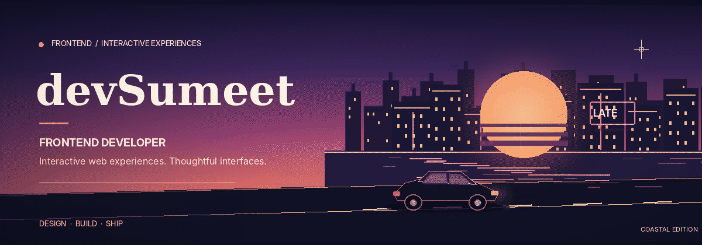

  

<h1 align="center">devSumeet</h1>

  <strong>Frontend Developer</strong> 
  Building interactive websites and thoughtful digital experiences.

  <a href="mailto:hello.sumeet.dev@gmail.com">Email</a> &nbsp;·&nbsp;
  <a href="https://github.com/isumeeto">GitHub</a>

---

## A little about me

I enjoy shaping ideas into usable interfaces — from responsive websites to animated, immersive web experiences. I care about the details: how something looks, how it feels to use, and how well it works.

## Selected work

<table>
  <tr>
    <td width="50%" valign="top">
      <h3><a href="https://github.com/isumeeto/fitmez">FitMez</a></h3>
      
<strong>Digital wardrobe & outfit styling</strong>

      
A fashion-focused web experience for managing a digital wardrobe and exploring outfit ideas.

      
My contribution: frontend development. Backend implementation is still pending.

      
<a href="https://fitmez.netlify.app">Live demo</a> &nbsp;·&nbsp; <a href="https://github.com/isumeeto/fitmez">Source</a>

    </td>
    <td width="50%" valign="top">
      <h3><a href="https://github.com/isumeeto/blue-dot">Blue Dot</a></h3>
      
<strong>Career discovery & personal planning</strong>

      
A platform for exploring possible directions, organising goals and reflecting on progress.

      
<a href="https://bluedot-1.netlify.app">Live demo</a> &nbsp;·&nbsp; <a href="https://github.com/isumeeto/blue-dot">Source</a>

    </td>
  </tr>
  <tr>
    <td width="50%" valign="top">
      <h3><a href="https://github.com/isumeeto/snowy.buddy">Snowy Buddy</a></h3>
      
<strong>Desktop companion</strong>

      
An experimental desktop companion project exploring voice interaction, reminders and desktop workflows.

      
Currently paused; I may return to it with new features.

      
<a href="https://github.com/isumeeto/snowy.buddy">Source</a>

    </td>
    <td width="50%" valign="top">
      <h3><a href="https://github.com/isumeeto/4Bit-frontend">4Bit VoiceCare</a></h3>
      
<strong>Hackathon project · frontend contribution</strong>

      
A grievance-management concept with voice-enabled reporting and administration workflows. I worked on the frontend showcase as part of the team.

      
<a href="https://github.com/isumeeto/4Bit-frontend">Frontend source</a>

    </td>
  </tr>
</table>

## Tools I work with

  
  
  
  
  
  
  

## GitHub at a glance

  
  

  

---

  <strong>Have something interesting to build?</strong> 
  <a href="mailto:hello.sumeet.dev@gmail.com">Let's talk</a>

